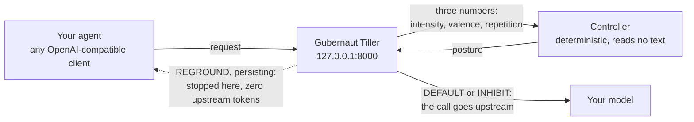

<p align="center">
  <picture>
    <source media="(prefers-color-scheme: dark)" srcset=".github/assets/logo-dark.svg">
    
  </picture>
</p>

<h1 align="center">Gubernaut</h1>

<p align="center">
  <b>Your agent stopped making progress. The bill did not.</b><br>
  Gubernaut spots an agent stuck in a loop and stops the next call before it is sent.
</p>

<p align="center">
  <a href="https://pypi.org/project/gubernaut-sdk/"></a>
  <a href="https://www.npmjs.com/package/@gubernaut/core"></a>
  <a href="https://github.com/thegubernaut/gubernaut/actions/workflows/ci.yml"></a>
  <a href="LICENSE"></a>
</p>

<p align="center">
  
</p>

<p align="center">
  <a href="https://gubernaut.com">gubernaut.com</a> ·
  <a href="docs/">Docs</a> ·
  <a href="docs/configuration.md">Configuration</a> ·
  <a href="docs/LIMITS.md">Limits</a> ·
  <a href="https://arxiv.org/abs/2607.24339">Paper</a>
</p>

An agent sends the same request again, word for word. Each retry sends the whole conversation back,
and you pay for all of it. Nothing inside the loop knows it is a loop. You find out from the bill.

## See it first

No API key, no network, under a second:

```bash
git clone https://github.com/thegubernaut/gubernaut && cd gubernaut
pip install gubernaut-sdk
python examples/hard_stop_demo.py
```

```
The same request, repeated 25 times  (■ billed  □ stopped, never billed)

  Nothing watching ■■■■■■■■■■■■■■■■■■■■■■■■■  25 tries, 25 billed
  With Gubernaut   ■■■□□□□□□□□□□□□□□□□□□□□□□  3 billed, stopped at try 4
```

The demo runs the real proxy on a local port, in front of a stand-in model that counts every request
that reaches it. Tries 1 to 3 still reach the model and are billed.

## Use it

Start **Gubernaut Tiller**, the proxy, then change one line in your code: the address your agent
sends its calls to.

```bash
pip install gubernaut-sdk
gubernaut-proxy --upstream https://api.openai.com     # binds 127.0.0.1:8000
```

```python
client = OpenAI(base_url="http://localhost:8000/v1")   # the one line of adoption
```

Any OpenAI-compatible client works. The OpenAI SDK, LangChain, LlamaIndex, AutoGen and ElizaOS each
adopt it in one line: [examples/](examples/). A stopped call comes back as an ordinary completion that
costs nothing, with a reply starting `[GCC]` and the header `x-gcc-hard-stop: true`.

| Product | How it runs | Install |
| --- | --- | --- |
| **Gubernaut Tiller** | A local proxy that speaks the OpenAI API. It stops a looping call itself | `pip install gubernaut-sdk` |
| **Gubernaut Keel** | A library inside your program. It decides, and your code does the stopping. No proxy, no network hop | `npm install @gubernaut/core` · `cargo add gubernaut-core` |
| ElizaOS plugin | A client of Tiller. It does nothing without the proxy running | `npm install @gubernaut/plugin-gcc` |

## How it works



Each turn, the controller reads three bounded numbers and nothing else, and holds one of three
postures: `DEFAULT` lets the call through, `INHIBIT` adds an instruction and clamps the temperature,
`REGROUND` breaks the loop and, if it persists, stops the call. Same input, same decision, every run.
If the proxy goes down, the agent stops. It never carries on unguarded.

More: [architecture](docs/ARCHITECTURE.md) · [postures](docs/POSTURES.md) · [determinism](docs/DETERMINISM.md)

## What it measured

On the verbatim-loop battery of the pre-registered receipts benchmark, Tiller saved **79.8% to
95.9%** of a runaway loop's bill, across seven measured configurations in four model families, with
both arms making the same number of attempts. The stop lands at turn 4, and turns 1 to 3 are sent and
billed.

| 25-attempt verbatim loop | Ungoverned | Governed |
| --- | --- | --- |
| GPT-5.6 Sol | $0.1669 | **$0.0068** |
| Claude Fable 5 | $0.3861 | **$0.0203** |

Gemini-native Gemma is free-tier only, so those rows are token deltas and carry no dollar claim. Every
number is a script output: [receipts/](receipts/). The research record, with the paper and its data:
[Gubernaut_Validation](https://github.com/thegubernaut/Gubernaut_Validation).

## What it does not do

- **It is not injection-proof.** Injection resistance is claimed for the controller only, the part that
  reads numbers and no text. That boundary is architectural and not yet adversarially tested.
- **It does not catch every loop.** Assistant and tool messages are not appraised, so a retry loop
  confined to those roles is outside what this detector covers.
- **The first three tries are paid.** The stop lands at turn 4.

Read [docs/LIMITS.md](docs/LIMITS.md) before you deploy it.

## Docs

| | |
| --- | --- |
| [Configuration](docs/configuration.md) | Flags, environment variables, routes, headers, errors |
| [Integrations](examples/) | OpenAI SDK, LangChain, LlamaIndex, AutoGen, ElizaOS |
| [Keel for JavaScript](packages/core-js/README.md) · [for Rust](packages/rust/README.md) | The in-process API |
| [FAQ](docs/FAQ.md) | System prompts, caps, latency, chains |
| [Reproduce the record](docs/REPRODUCE.md) | Three levels run on your machine without an API key |

## For AI coding agents

- **[AGENTS.md](AGENTS.md)** tells Codex, Claude Code, Cursor and other agents how to build, test and
  change this repository.
- **[llms.txt](llms.txt)** is the map of these docs for a model to read.
- **The Gubernaut skill** teaches an agent to add Tiller or Keel to your project and prove the stop works.
  - Claude Code: `/plugin marketplace add thegubernaut/gubernaut`, then `/plugin install gubernaut@gubernaut`.
  - Codex, Cursor, Gemini CLI, Antigravity: copy [skills/gubernaut/](skills/gubernaut/) into your project's
    `.agents/skills/`.

## Reproduce it, or break it

The controller is input-deterministic, the data is CC-BY, and the paper is public. Rerun the record
([docs/REPRODUCE.md](docs/REPRODUCE.md)) and post what you get, matching or not, in
[Discussions](https://github.com/thegubernaut/gubernaut/discussions) or as a
[reproduction report](https://github.com/thegubernaut/gubernaut/issues/new?template=reproduction.yml).
A result that disagrees with ours is more useful to us than one that agrees.

To hear about the next version without signing up to anything: **Watch → Custom → Releases**.

## License and citation

Code under [Apache-2.0](LICENSE), research data under CC-BY-4.0. Free and self-hosted: no account, no
key, and nothing is sent back. Cite the concept DOI
[10.5281/zenodo.21303518](https://doi.org/10.5281/zenodo.21303518) ([CITATION.cff](CITATION.cff)).

[Contributing](CONTRIBUTING.md) · [Security](SECURITY.md) · [Changelog](CHANGELOG.md) ·
[contact@gubernaut.com](mailto:contact@gubernaut.com)
